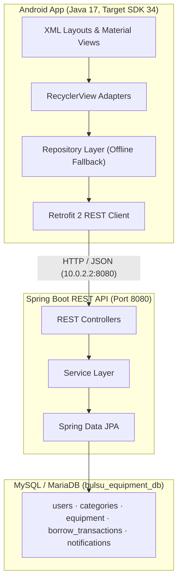

<div align="center">

# BulSU COE Equipment Borrowing System

**A mobile-based laboratory equipment borrowing and inventory management system for the Bulacan State University – College of Engineering.**

[-3DDC84?logo=android&logoColor=white)](https://developer.android.com)
[](https://spring.io/projects/spring-boot)
[](https://www.mysql.com)
[](https://openjdk.org)
[](https://developer.android.com)
[](#-license)

[Features](#-features) ·
[Architecture](#-architecture) ·
[Getting Started](#-getting-started) ·
[API Reference](#-rest-api-reference) ·
[Project Structure](#-project-structure)

</div>

---

## 📖 Overview

The **BulSU COE Equipment Borrowing System (BSU-COE-EBS)** replaces manual laboratory borrowing logs with a centralized platform. Students and faculty can browse available equipment, submit borrow requests, and track their loan history from an Android app, while laboratory administrators review requests, approve or reject them with remarks, and monitor stock and returns in real time.

The Android client is built from the official Figma prototype and talks to a Spring Boot REST API backed by a MySQL/MariaDB database.

### Downloads

| Resource | Link |
| :--- | :--- |
| **Android APK (debug build)** | [`releases/BulSU_Equipment_Borrowing_System.apk`](releases/BulSU_Equipment_Borrowing_System.apk) |
| **Backend API / Web Portal** | `http://localhost:8080/` (when running locally) |

---

## ✨ Features

**For Borrowers (Students / Faculty)**
- Secure sign up and login with role-based routing
- Home dashboard with live counts (available equipment, active requests)
- Equipment catalog with instant search and category filters
- Borrow flow with quantity stepper limited to available stock, date pickers, and a loan summary
- Request history with status filters and detailed request view
- Equipment return with condition checklist and accessories verification
- Profile with loan summary (Borrowed / Pending / Returned)
- In-app notifications for status changes

**For Laboratory Administrators**
- Admin dashboard to review all borrowing transactions
- One-tap approve or reject, with required remarks on rejection
- Automatic stock deduction on approval and restoration on return
- Transaction auditing with unique transaction IDs (`TRX-YYYYMMDD-XXX`)

**System**
- Dynamic counts computed from the database, not hard-coded
- Offline-tolerant repository layer: the app keeps working with cached/fallback data while the backend restarts
- Duplicate student ID prevention and input validation with feedback dialogs

---

## 🏛️ Architecture



### Technology Stack

| Layer | Technology |
| :--- | :--- |
| Mobile | Native Android (Java 17), XML layouts, Vector Drawables |
| SDK | Compile/Target SDK 34 (Android 14), Min SDK 24 (Android 7.0) |
| Networking | Retrofit 2.9, OkHttp3, Gson |
| Backend | Java Spring Boot 3.2.5, Spring Data JPA, Hibernate |
| Database | MySQL / MariaDB (port 3306) |
| Build tools | Gradle 8.2 (Android), Apache Maven 3.8+ (Backend) |

---

## 📱 Screens

| Screen | Layout | Component | Description |
| :--- | :--- | :--- | :--- |
| Login | `activity_login.xml` | `LoginActivity` | Branded login, password toggle, role-based routing |
| Sign Up | `activity_signup.xml` | `SignUpActivity` | Student ID registration with confirm-password validation |
| Home | `fragment_home.xml` | `HomeFragment` | Live counters, category selector, featured equipment |
| Catalog | `fragment_catalog.xml` | `CatalogFragment` | Real-time search and category filter pills |
| Borrow | `activity_borrow.xml` | `BorrowActivity` | Stock-bounded quantity stepper, date pickers, summary |
| History | `fragment_history.xml` | `HistoryFragment` | Status filters with color-coded badges |
| Request Details | `activity_request_detail.xml` | `RequestDetailActivity` | Full request breakdown and return shortcut |
| Return | `activity_return.xml` | `ReturnActivity` | Condition checklist, accessories check, remarks |
| Profile | `fragment_profile.xml` | `ProfileFragment` | User info, loan summary, logout |
| Feedback Dialogs | `dialog_*.xml` | `FeedbackDialogHelper` | Stock alerts, confirmations, errors, rejection remarks, notifications |
| Admin Panel | `activity_admin_dashboard.xml` | `AdminDashboardActivity` | Approve / reject requests, inventory oversight |

> 📸 **Screenshots:** add images to `docs/screenshots/` and reference them here, e.g. ``.

---

## 🚀 Getting Started

### Prerequisites

- **Android Studio** (latest stable) with an emulator or physical device (Android 7.0+)
- **JDK 17**
- **MySQL 8 / MariaDB 10+** running on port 3306
- **Apache Maven 3.8+** (or use the provided `run_backend.bat`)

### Option 1 — Install the APK (quickest)

```bash
adb install -r releases/BulSU_Equipment_Borrowing_System.apk
```

You can also drag and drop the `.apk` onto a running emulator or copy it to an Android phone.

### Option 2 — Run from Android Studio

1. Open **Android Studio** → **File → Open** and select the `android/` folder.
2. Let Gradle sync.
3. Start an emulator or connect a device with USB debugging enabled.
4. Press **Run ▶** (`Shift + F10`).

### Option 3 — Run the Backend and Database

1. **Import the database** (MySQL/MariaDB must be running):

   ```cmd
   import_database.bat
   ```

   Or import `database/bulsu_equipment_db.sql` using phpMyAdmin or the MySQL CLI.

2. **Configure credentials** in `backend/src/main/resources/application.properties`:

   ```properties
   spring.datasource.url=jdbc:mysql://localhost:3306/bulsu_equipment_db
   spring.datasource.username=your_username
   spring.datasource.password=your_password
   ```

3. **Start the server:**

   ```cmd
   run_backend.bat
   ```

   The API and web portal will be available at `http://localhost:8080/`.

> **Emulator note:** the Android emulator reaches your computer's `localhost` through `10.0.2.2`. On a physical device, change the API base URL in `ApiClient` to your computer's LAN IP address.

---

## 🔑 Demo Accounts

These accounts are seeded for testing only. **Change or remove them before any real deployment.**

| Role | Username | Password | Access |
| :--- | :--- | :--- | :--- |
| Borrower | `2024101234` | `JuAnPoGi123` | Catalog, borrow requests, history, returns, profile |
| Lab Administrator | `admin2026` | `Admin@123` | Dashboard, approvals/rejections, transaction auditing |

---

## 📡 REST API Reference

| Method | Endpoint | Description | Role |
| :--- | :--- | :--- | :--- |
| `POST` | `/api/auth/login` | Authenticate a borrower or administrator | Public |
| `POST` | `/api/auth/register` | Register a new student borrower | Public |
| `GET` | `/api/auth/profile/{userId}` | Get profile information | Borrower |
| `GET` | `/api/dashboard/stats/{userId}` | Available equipment and request counts | Borrower |
| `GET` | `/api/equipment` | List equipment (search and category filter) | Public |
| `GET` | `/api/equipment/featured` | Get featured equipment | Public |
| `POST` | `/api/borrow` | Submit a borrow request | Borrower |
| `POST` | `/api/borrow/return` | Submit a return request | Borrower |
| `GET` | `/api/borrow/user/{userId}` | Get a user's transaction history (filterable) | Borrower |
| `GET` | `/api/admin/transactions` | View all transactions | Admin |
| `POST` | `/api/admin/transactions/{id}/approve` | Approve a request and deduct stock | Admin |
| `POST` | `/api/admin/transactions/{id}/reject` | Reject a request with remarks | Admin |

---

## 🗄️ Database Schema

Database: `bulsu_equipment_db`

| Table | Purpose |
| :--- | :--- |
| `users` | Accounts, student IDs, hashed passwords, roles (`BORROWER`, `ADMIN`), course, section, contact info |
| `categories` | Tools & Repairs, Electronics & Components, Testing & Management, Others |
| `equipment` | Inventory items with codes (`EQ-001`…), total/available quantity, condition, accessories, image |
| `borrow_transactions` | Loans with IDs (`TRX-YYYYMMDD-XXX`), dates, status (`PENDING`, `APPROVED`, `RETURNED`, `REJECTED`, `OVERDUE`), accessories, admin remarks |
| `notifications` | Status-change alerts for borrowers |

---

## 📁 Project Structure

```
bulsu-equipment-borrowing-system/
├── README.md
├── .gitignore
├── import_database.bat            # Imports schema and seed data
├── run_backend.bat                # Starts the Spring Boot API
│
├── releases/
│   └── BulSU_Equipment_Borrowing_System.apk
│
├── android/                       # Android Studio project
│   └── app/src/main/
│       ├── AndroidManifest.xml
│       ├── java/edu/bulsu/equipmentborrowing/
│       │   ├── model/             # User, Equipment, Category, BorrowTransaction
│       │   ├── network/           # ApiClient, ApiService (Retrofit)
│       │   ├── repository/        # EquipmentRepository, BorrowRepository
│       │   ├── ui/                # Activities and Fragments
│       │   └── utils/             # SessionManager, UiUtils
│       └── res/                   # Layouts, drawables, strings, colors, styles
│
├── backend/                       # Spring Boot REST API
│   ├── pom.xml
│   └── src/main/
│       ├── java/edu/bulsu/equipment/backend/
│       └── resources/
│           ├── application.properties
│           └── static/index.html  # Web portal
│
└── database/
    └── bulsu_equipment_db.sql     # Schema and seed data
```

---

## 🛠️ Troubleshooting

| Problem | Solution |
| :--- | :--- |
| App shows data but changes don't save | The backend is likely offline. Start it with `run_backend.bat` and confirm port 8080 is free. |
| Backend fails to start | Check MySQL is running and the credentials in `application.properties` are correct. |
| Physical device can't connect | Use your PC's LAN IP instead of `10.0.2.2` and allow port 8080 through the firewall. |
| Gradle sync fails | Make sure Android Studio uses JDK 17 (**Settings → Build Tools → Gradle**). |

---

## 🗺️ Roadmap

- [ ] Push notifications for approvals and due dates
- [ ] QR-code scanning for equipment check-out and return
- [ ] Overdue reminders and penalty tracking
- [ ] Admin inventory management (add, edit, retire equipment)
- [ ] Exportable transaction reports (PDF / CSV)


**Institution:** Bulacan State University – College of Engineering

---

## 📄 License

This project was developed for academic purposes at Bulacan State University – College of Engineering. All rights reserved by the authors unless a `LICENSE` file states otherwise.
